# Fase 5 — Mockup · Sistema de Tienda Virtual

**SENA · ADSO · Ficha 3239188 · Grupo 03**
**Integrantes:** Sebastián Calderón Briñez, Luis Alfredo Corrales Arrieta, Juan José Cuéllar Rojas
**Instructor:** Carlos Julio Cadena

---

## 🔗 Prototipo navegable

### 👉 [Abrir el mockup interactivo](https://claude.ai/artifact/N13mHTbbtcnF7Y1WYjJyyc)

Para recorrerlo, abra el enlace y presione **Play** sobre la pantalla **1 · Inicio**. Las pantallas están enlazadas entre sí, y los formularios, filtros y mensajes funcionan.

**Cuentas de prueba**

| Correo | Contraseña | Resultado |
|---|---|---|
| `admin@tienda.com` | `Admin123` | Entra al dashboard del administrador |
| `cliente@correo.com` | `Cliente123` | Entra al catálogo como cliente |
| `inactivo@tienda.com` | cualquiera | Muestra *"Esta cuenta se encuentra inactiva"* |

**Recorridos sugeridos**

1. **Compra del cliente:** Inicio → Catálogo → Carrito → Dirección → Pago → Confirmación → Mis pedidos
2. **Gestión de pedidos:** Login (admin) → Dashboard → Pedidos → Detalle → avanzar estado, asignar domiciliario y generar factura
3. **Inventario:** Dashboard → Inventario → Registrar movimiento → Historial de movimientos

---

## ✅ Checklist de la fase

| Requisito de la Fase 5 | Pantalla |
|---|---|
| Definir estructura de navegación | [0 · Estructura de navegación](#0--estructura-de-navegación) |
| Diseñar pantalla de inicio | [1 · Inicio](#1--inicio) |
| Login / registro | [2 · Login y registro](#2--login-y-registro) |
| Dashboard | [6 · Dashboard](#6--dashboard) |
| Formularios | [4 · Carrito y checkout](#4--carrito-y-checkout) · [9 · Formulario de producto](#9--formulario-de-producto) |
| Listados | [7 · Listado de pedidos](#7--listado-de-pedidos) |
| Consultas | [3 · Catálogo](#3--catálogo-y-búsqueda) · [10 · Inventario](#10--inventario) |
| Detalle de registros | [8 · Detalle de pedido](#8--detalle-de-pedido) |
| Mensajes de error y confirmación | [11 · Mensajes](#11--mensajes-de-error-y-confirmación) |
| Prototipo navegable | [Enlace arriba](#-prototipo-navegable) |

---

## 0 · Estructura de navegación

Una sola entrada pública y un único login que redirige según el rol (RNF-002). De ahí salen dos ramas: el **canal en línea** del cliente y el **back-office** del personal interno, organizado por los 5 roles internos de la Fase 1.

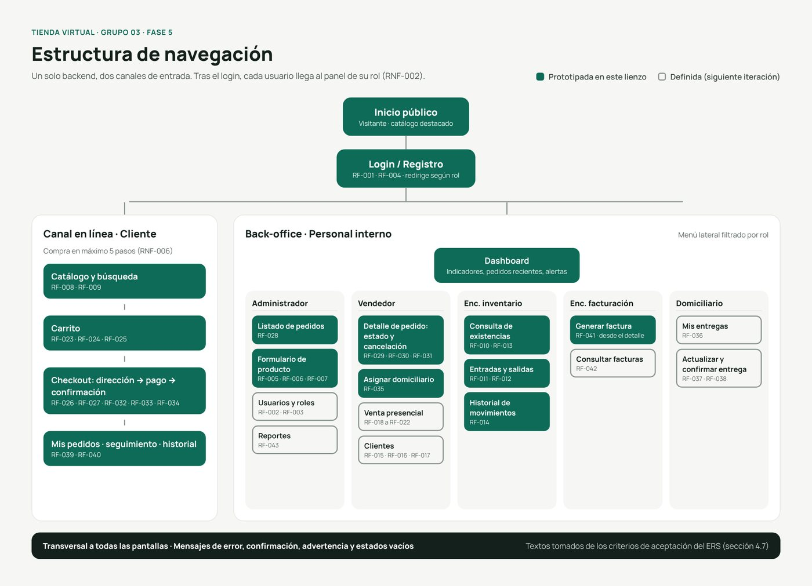

## 1 · Inicio

Página pública con buscador, categorías y productos destacados. Si un producto no tiene existencia, el botón de compra se deshabilita (RN-002).
**RF:** RF-008, RF-023

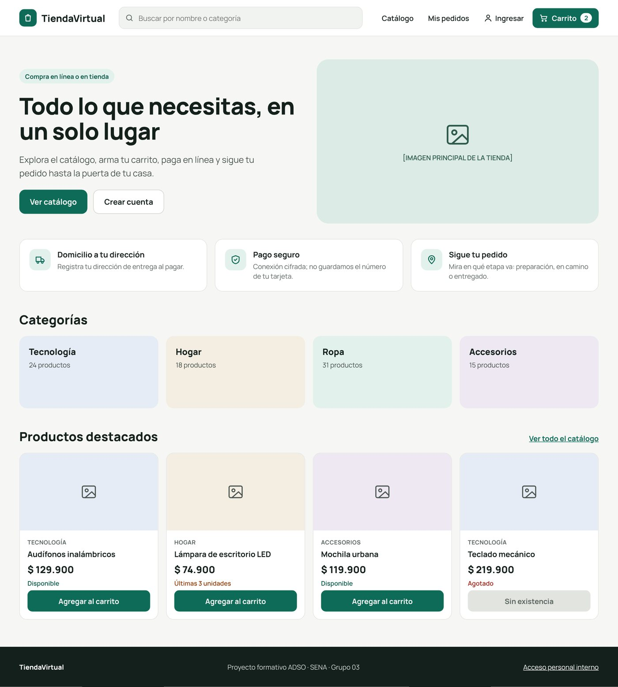

## 2 · Login y registro

Un solo acceso para clientes y personal. Valida campos vacíos, credenciales incorrectas, cuenta inactiva, correo duplicado y contraseña insegura.
**RF:** RF-001, RF-004 · **RNF:** RNF-002, RNF-003

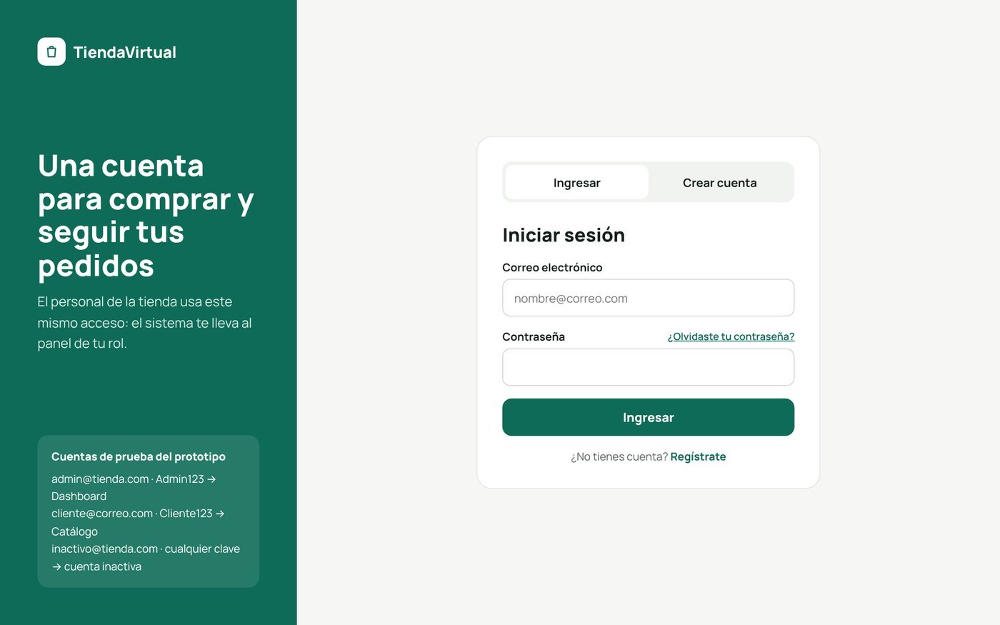

## 3 · Catálogo y búsqueda

Búsqueda por nombre, categoría o código, con filtros por categoría y ordenamiento por precio. Cuando no hay resultados se muestra un estado vacío.
**RF:** RF-008, RF-009, RF-023

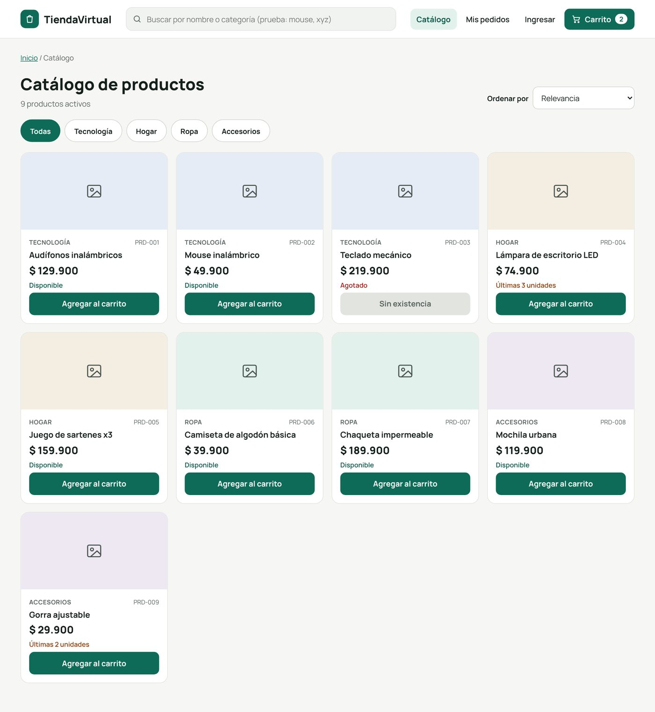

## 4 · Carrito y checkout

Compra en 4 pasos (RNF-006): carrito → dirección → pago → confirmación. El total es cantidad × precio (RN-008), y no se puede continuar con el carrito vacío (RN-001). El pago puede resultar aprobado o rechazado.
**RF:** RF-023 a RF-027, RF-032 a RF-034 · **RNF:** RNF-004

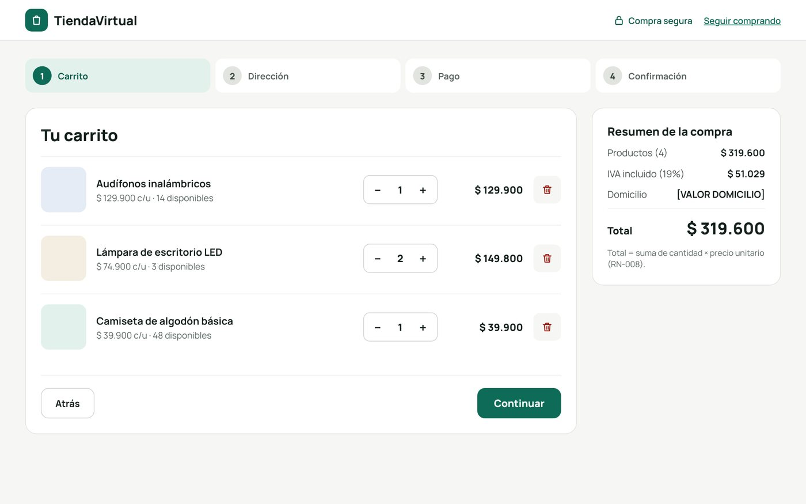

## 5 · Mis pedidos y seguimiento

Historial de compras y línea de seguimiento del pedido: pendiente → en preparación → en camino → entregado.
**RF:** RF-034, RF-039, RF-040

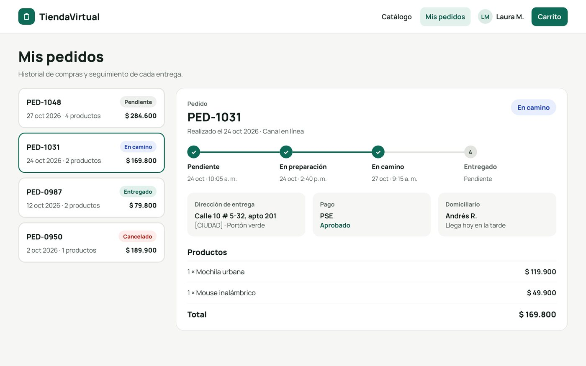

## 6 · Dashboard

Indicadores, ventas de los últimos 7 días por canal, alertas de stock bajo y pedidos recientes.
**RF:** RF-013, RF-028, RF-043

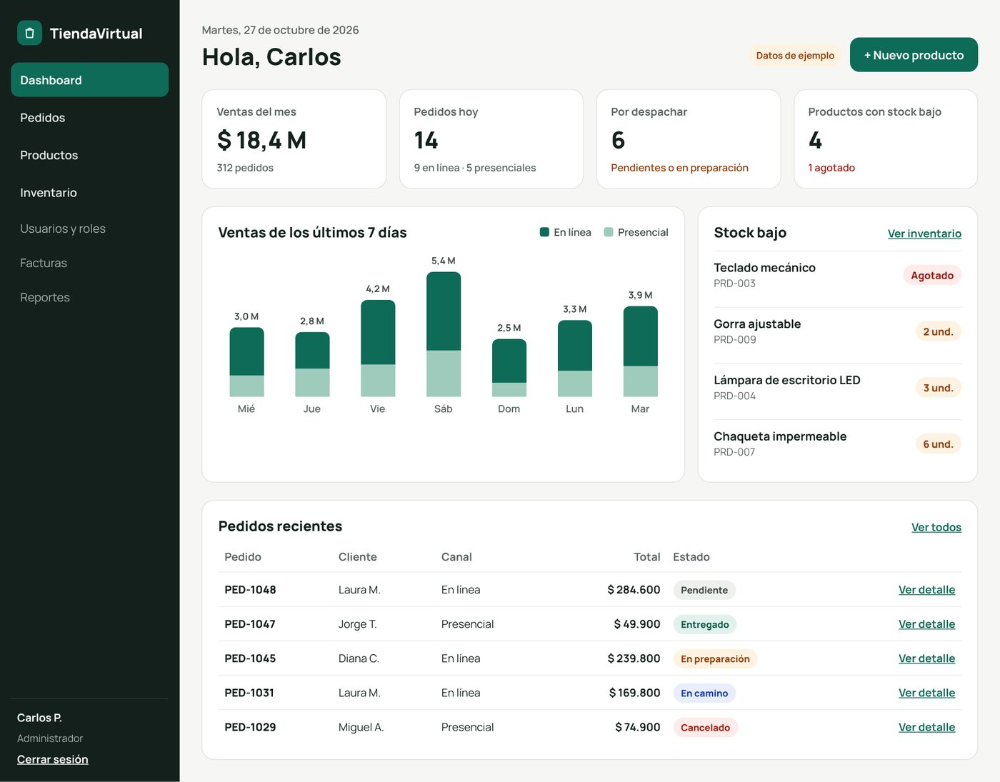

## 7 · Listado de pedidos

Listado paginado con búsqueda y filtros por estado y canal.
**RF:** RF-028

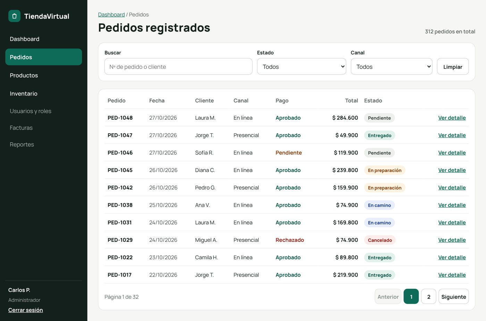

## 8 · Detalle de pedido

Productos, cliente, pago, domicilio, factura e historial del pedido. El estado solo avanza en orden (RN-004), solo se puede cancelar si está pendiente o en preparación (RN-003) y la factura se genera después de aprobado el pago (RN-006).
**RF:** RF-029, RF-030, RF-031, RF-035, RF-041

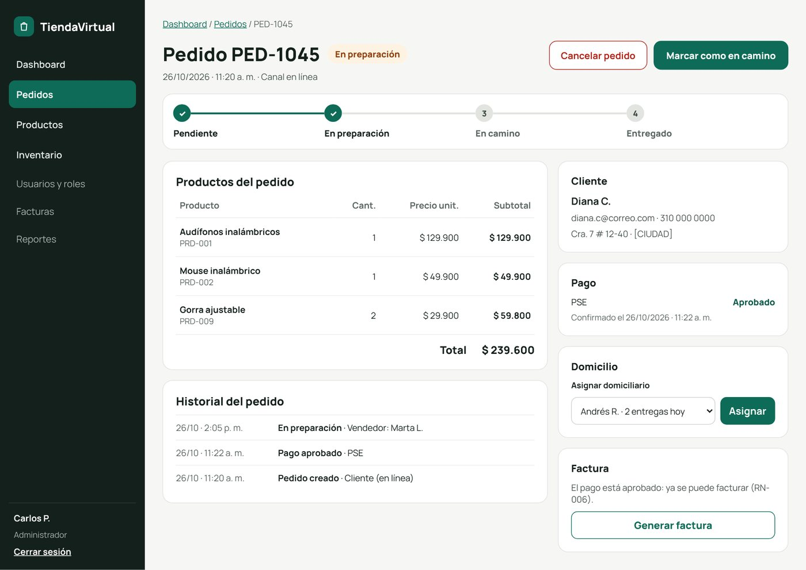

## 9 · Formulario de producto

Campos obligatorios, validación por campo y vista previa en el catálogo. Rechaza códigos repetidos.
**RF:** RF-005, RF-006, RF-007

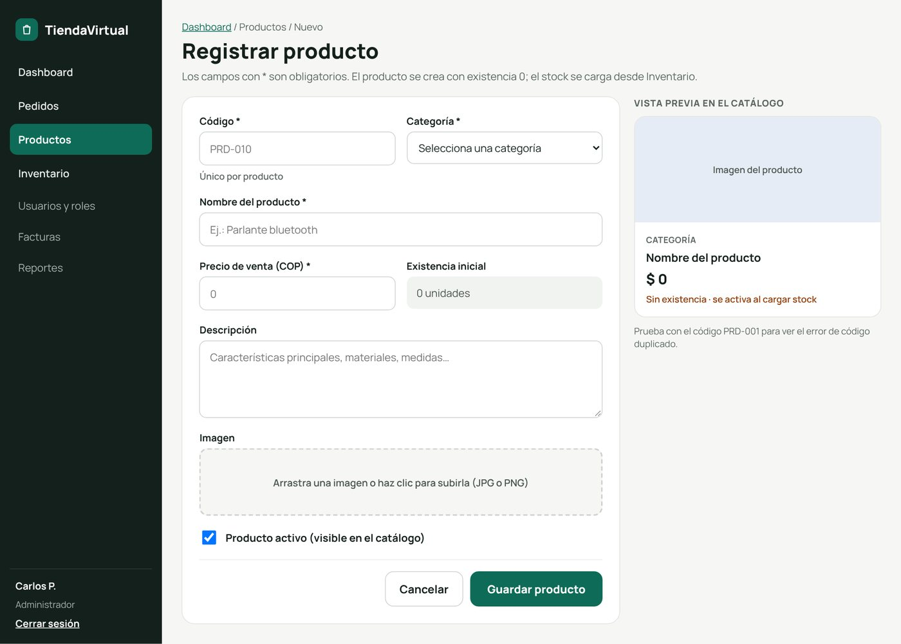

## 10 · Inventario

Consulta de existencias, historial de movimientos y registro de entradas y salidas. Una salida mayor a la existencia muestra *"Existencia insuficiente"*.
**RF:** RF-010 a RF-014 · **RNF:** RNF-008

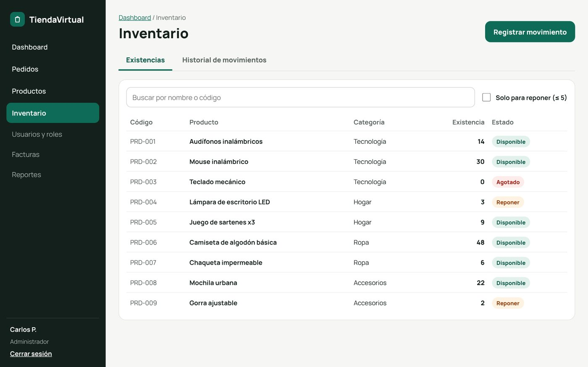

## 11 · Mensajes de error y confirmación

Guía con los textos exactos de los criterios de aceptación del ERS (sección 4.7). Incluye validación en campo, alertas, confirmaciones, diálogos de confirmación y estados vacíos.

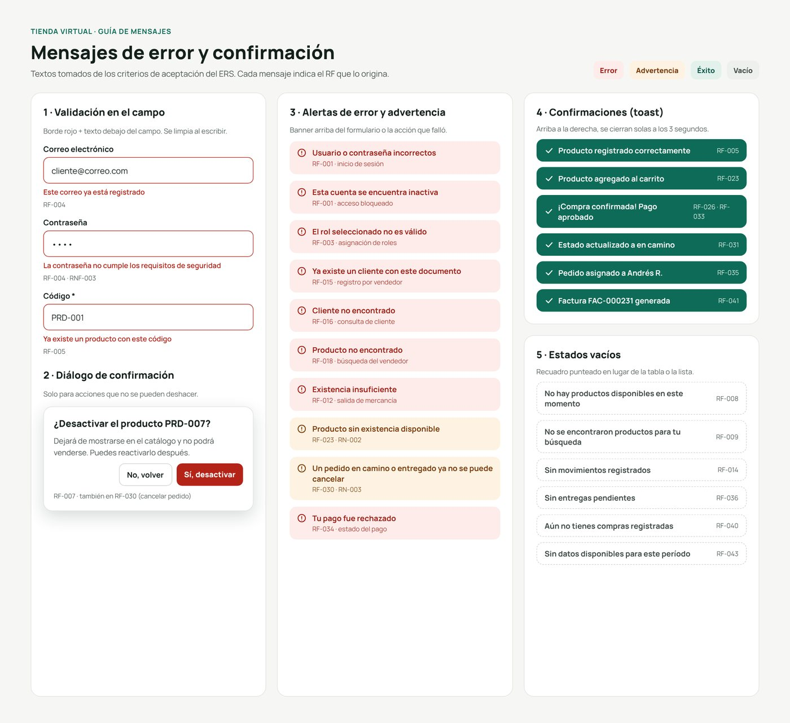

---

## 📌 Pendiente para la siguiente iteración

Estas pantallas ya están definidas en la estructura de navegación, pero no prototipadas:

- Usuarios y roles (RF-002, RF-003)
- Venta presencial y clientes (RF-015 a RF-022)
- Panel del domiciliario (RF-036 a RF-038)
- Consulta de facturas (RF-042)
- Reportes (RF-043)

> Los productos, valores y nombres del mockup son datos de ejemplo.
