# Fase 5 — Mockup · Sistema de Tienda Virtual (versión 2)

**SENA · ADSO · Ficha 3239188 · Grupo 03**
**Integrantes:** Sebastián Calderón Briñez, Luis Alfredo Corrales Arrieta, Juan José Cuéllar Rojas
**Instructor:** Carlos Julio Cadena

> **Versión 2 (09/11/2026).** Ajustada según la retroalimentación del instructor: paleta tecnológica, barra de navegación y migas de pan unificadas, vistas para los **6 roles**, acceso del Administrador a facturas (RF-042), accesibilidad y ortografía. El documento corregido es `PROYECTO_TIENDA_VIRTUAL_GRUPO_3_FASE_5.docx`.

---

## 🔗 Prototipo navegable

### 👉 [Abrir el mockup interactivo](https://claude.ai/artifact/N13mHTbbtcnF7Y1WYjJyyc)

Abra el enlace y presione **Play** sobre la pantalla **1 · Inicio** o **2 · Login**. Las pantallas están enlazadas entre sí, y los formularios, filtros y mensajes funcionan.

**Cuentas de prueba** (las mismas de la tabla `users` del script SQL)

| Correo | Contraseña | Llega a |
|---|---|---|
| `admin@tienda.com` | `Tienda123` | Dashboard del Administrador |
| `vendedor@tienda.com` | `Tienda123` | Venta presencial (Vendedor) |
| `inventario@tienda.com` | `Tienda123` | Existencias (Encargado de inventario) |
| `facturacion@tienda.com` | `Tienda123` | Facturas (Encargado de facturación) |
| `domiciliario@tienda.com` | `Tienda123` | Mis entregas (Domiciliario, móvil) |
| `laura.gomez@correo.com` | `Cliente123` | Catálogo (Cliente) |
| `inactivo@tienda.com` | cualquiera | Mensaje *"Esta cuenta se encuentra inactiva"* |

---

## ✅ Ajustes según la retroalimentación

| Obs. | Hallazgo | Ajuste realizado |
|---|---|---|
| 01 | Verde claro poco coherente con una tienda de tecnología | Paleta azul marino `#0F172A` y azul `#2563EB`. El verde queda **solo** para estados (disponible, aprobado, entregado) |
| 02 | La barra de navegación cambiaba entre pantallas | Un solo componente de barra global, idéntico en Inicio, Catálogo, Carrito y Mis pedidos |
| 03 | Migas de pan inconsistentes y sin enlaces | Componente único `Inicio / Sección / Actual` con enlaces, en todas las vistas interiores |
| 04 | Ortografía | Corregidos *APRENDICES*, *ETAPA LECTIVA*, *en preparación* y *cancelación desde* en RN-003 a RN-005, y 42 tildes en la sección de Base de datos |
| 05 / 07 | Faltaban vistas para 4 de los 6 roles | Se **conservan los 6 roles** (opción A) y se diseñaron sus vistas: Venta presencial, Movimientos con motivo, Facturas y Mis entregas (móvil) |
| 06 | El Administrador no veía facturas | RF-042 incluye al **Administrador** (consulta y supervisión), con el nuevo criterio CA-03 y la pantalla Facturas en su menú |
| Accesibilidad | Contraste, deshabilitados, color | Texto secundario `#475569`, botones deshabilitados con ícono + texto + `cursor: not-allowed`, íconos en la línea de seguimiento |

---

## 0 · Estructura de navegación por rol

Un acceso único redirige a cada rol a su panel (RNF-002). El menú lateral muestra solo los módulos de ese rol.

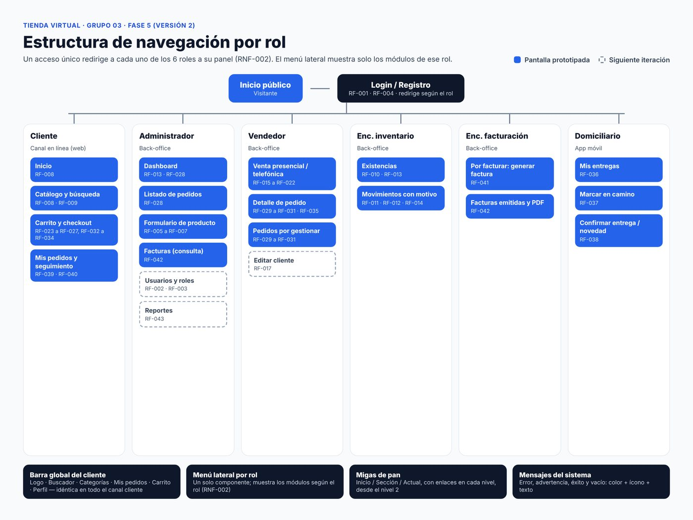

## Canal en línea · Cliente

### 1 · Inicio
Barra global, categorías (Computadores, Celulares, Monitores, Accesorios) y productos destacados. Un producto agotado muestra el botón deshabilitado con ícono y cursor no permitido (RN-002). **RF:** RF-008, RF-023

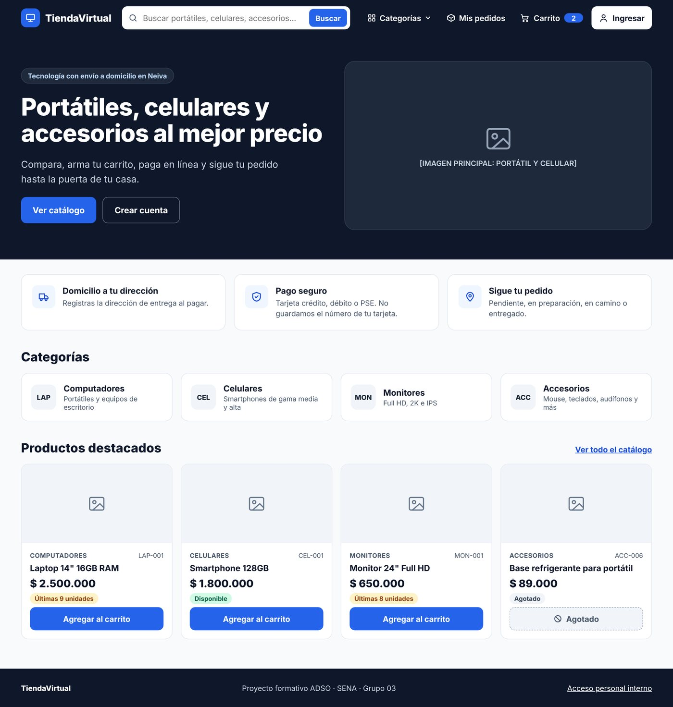

### 2 · Login y registro
Un acceso para los 6 roles. Valida credenciales, cuenta inactiva, correo duplicado y contraseña insegura. **RF:** RF-001, RF-004 · **RNF:** RNF-002, RNF-003

### 3 · Catálogo y búsqueda
El buscador de la barra global filtra el catálogo. Las migas de pan cambian con la categoría. **RF:** RF-008, RF-009, RF-023

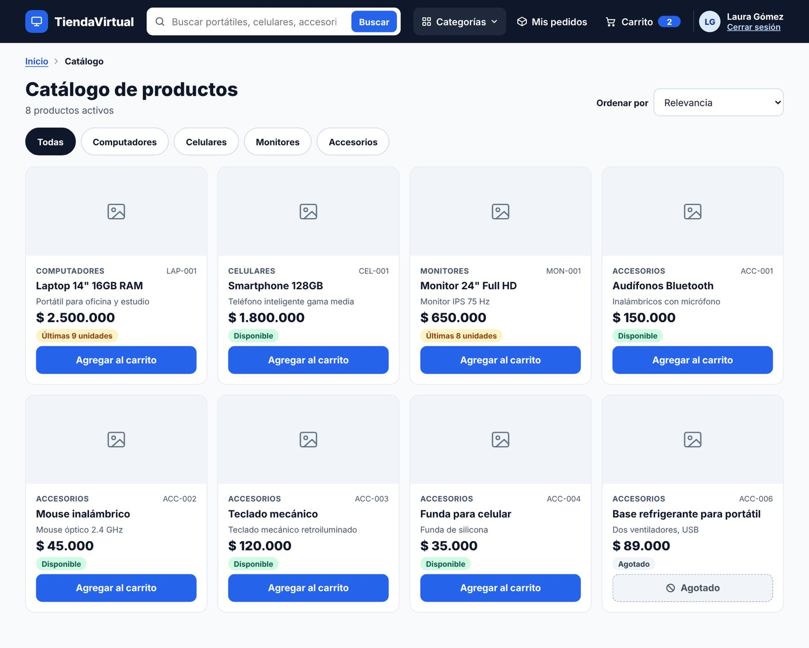

### 4 · Carrito y checkout
Cuatro pasos: carrito → dirección → pago (crédito, débito o PSE) → confirmación. Subtotal, IVA del 19 % y total. **RF:** RF-023 a RF-027, RF-032 a RF-034

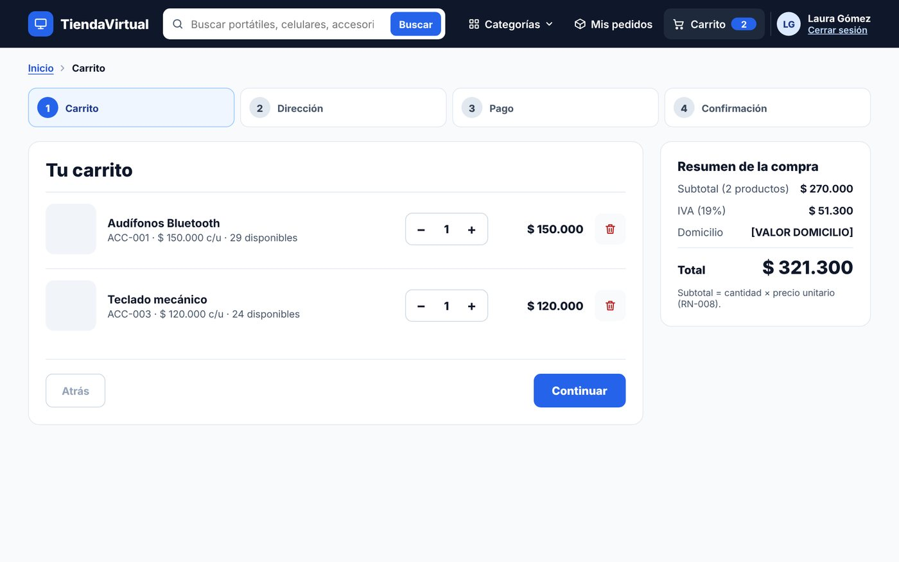

### 5 · Mis pedidos y seguimiento
Línea de seguimiento con un ícono por etapa (reloj, caja, camión, check) y texto de estado; no depende solo del color. **RF:** RF-034, RF-039, RF-040

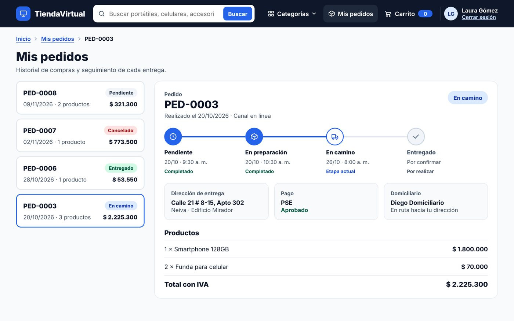

## Back-office · Vistas por rol

### 6 · Dashboard — Administrador
Indicadores, ventas por canal, stock bajo, pedidos recientes y acceso a Facturas. **RF:** RF-013, RF-028

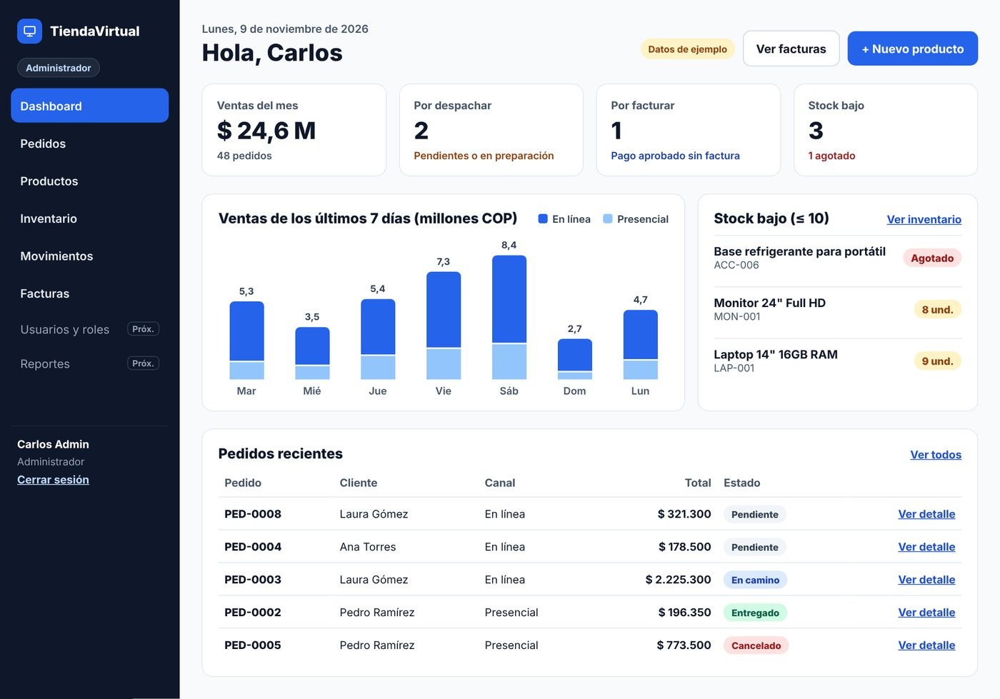

### 7 · Listado de pedidos — Administrador
Búsqueda y filtros por estado y por canal (en línea, presencial, telefónico). **RF:** RF-028

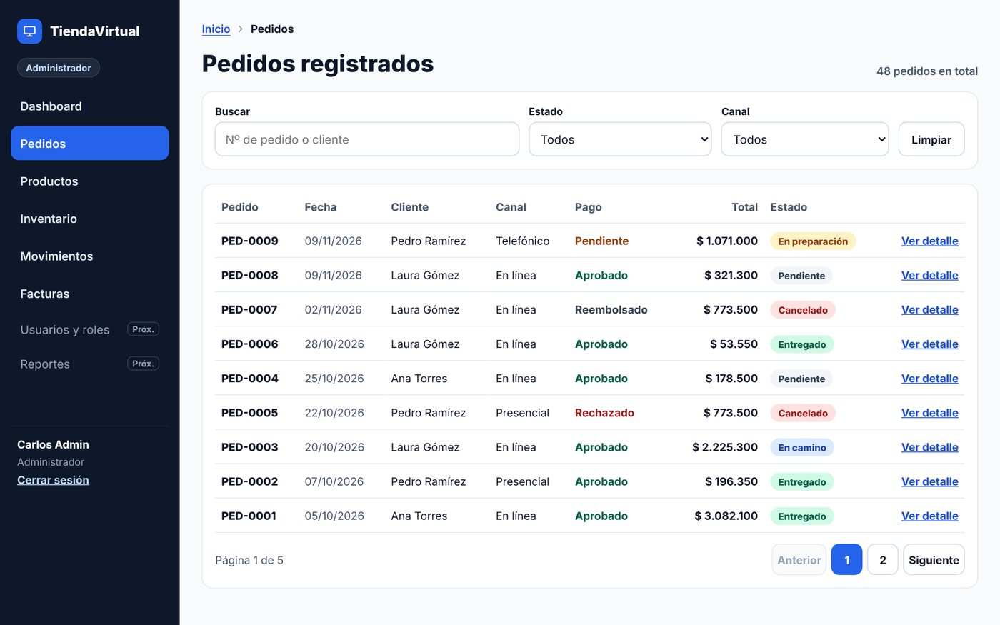

### 8 · Detalle de pedido — Vendedor
Avanzar estado (RN-004), cancelar con confirmación (RN-003), asignar domiciliario antes de "en camino". La factura la genera Facturación (RN-006). **RF:** RF-029, RF-030, RF-031, RF-035

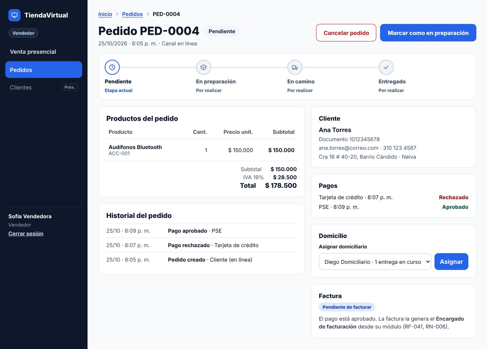

### 9 · Venta presencial y telefónica — Vendedor *(nueva)*
Punto de venta: cliente por documento (o registro si no existe), búsqueda de productos, cantidades, total con IVA, canal y registro de la venta. **RF:** RF-015, RF-016, RF-018 a RF-022

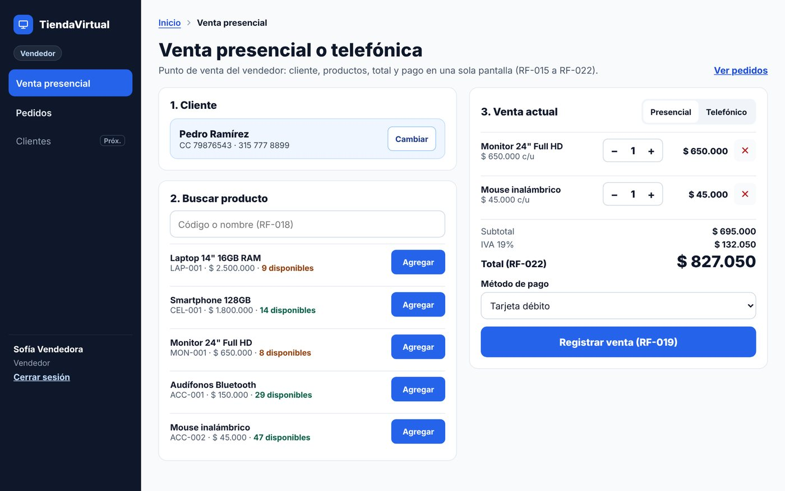

### 10 · Formulario de producto — Administrador
Validación por campo, código único (prueba `LAP-001`) y vista previa. **RF:** RF-005, RF-006, RF-007

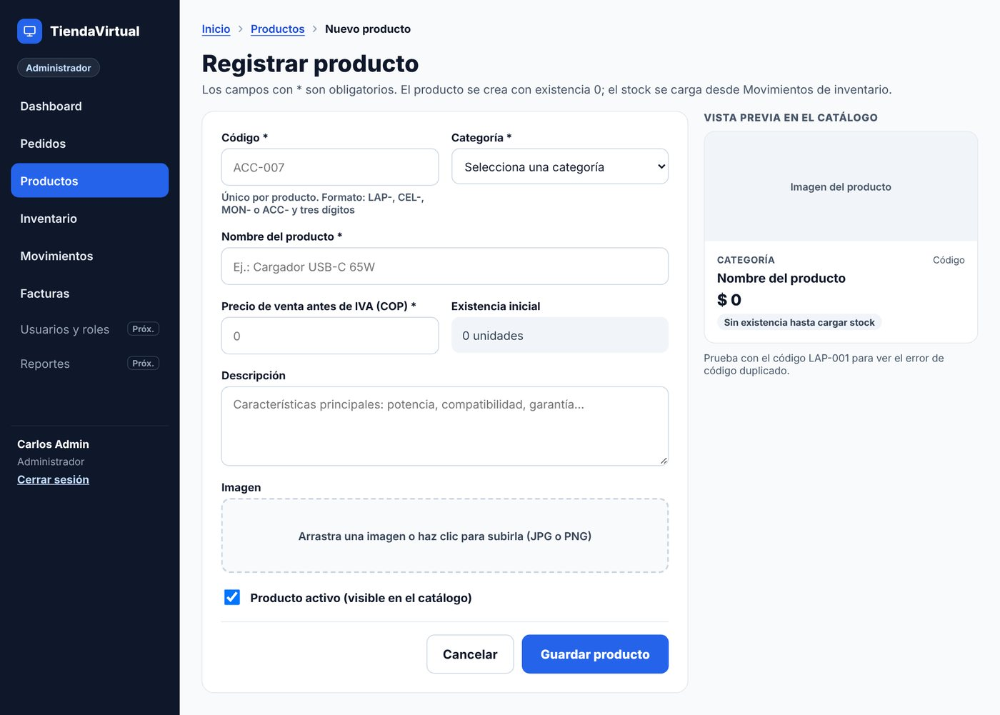

### 11 · Existencias — Encargado de inventario
Stock por producto, por reponer (≤ 10), agotados e inactivos. **RF:** RF-010, RF-013

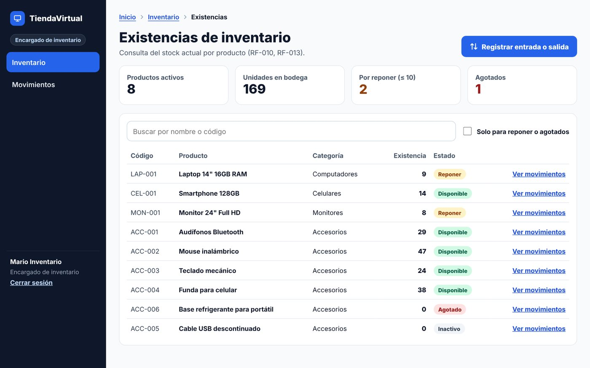

### 12 · Movimientos con motivo — Encargado de inventario *(nueva)*
Entrada o salida con **motivo obligatorio** y observación; historial con tipo, motivo y usuario. **RF:** RF-011, RF-012, RF-014

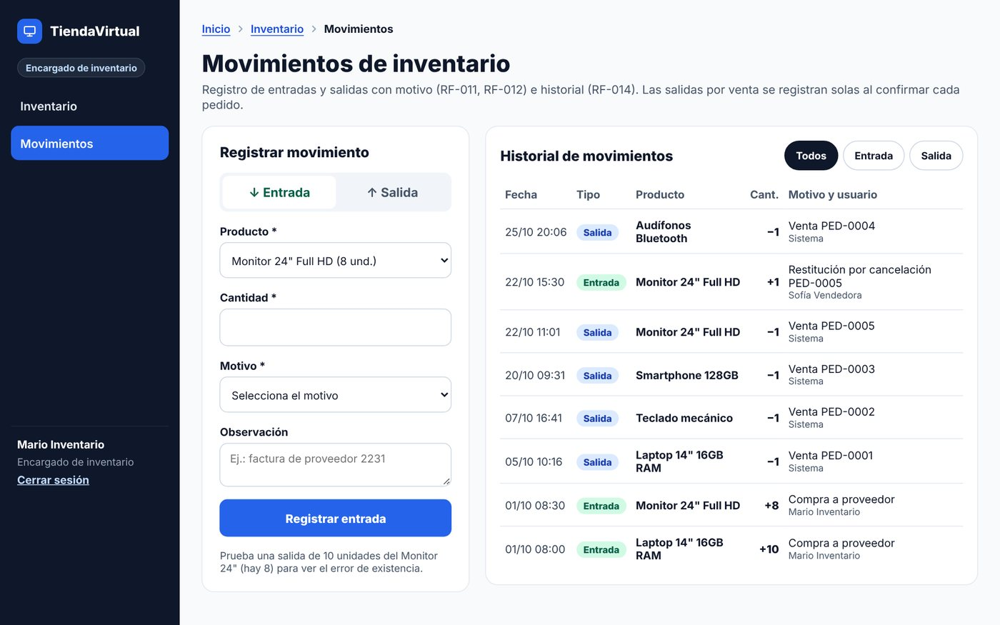

### 13 · Facturas — Encargado de facturación y Administrador *(nueva)*
Libro de facturas (FV-0001 a FV-0003), vista de la factura y descarga en PDF. Facturación genera las facturas pendientes; el Administrador consulta en solo lectura. **RF:** RF-041, RF-042

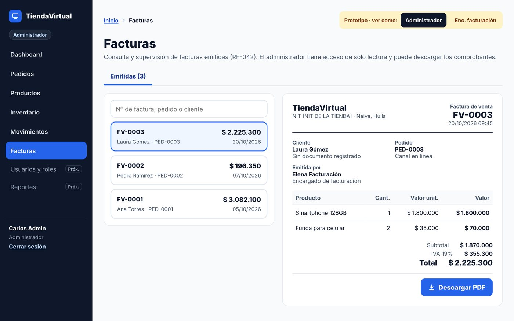

### 14 · Mis entregas — Domiciliario, móvil *(nueva)*
Pedidos asignados, marcar "en camino", confirmar entrega con nombre de quien recibe o reportar novedad. **RF:** RF-036, RF-037, RF-038

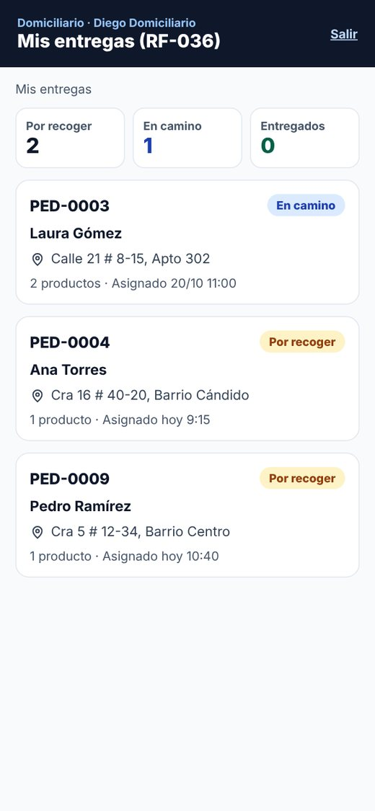

## 15 · Mensajes de error y confirmación
Textos de los criterios de aceptación del ERS. Cada tipo combina color, ícono y texto.

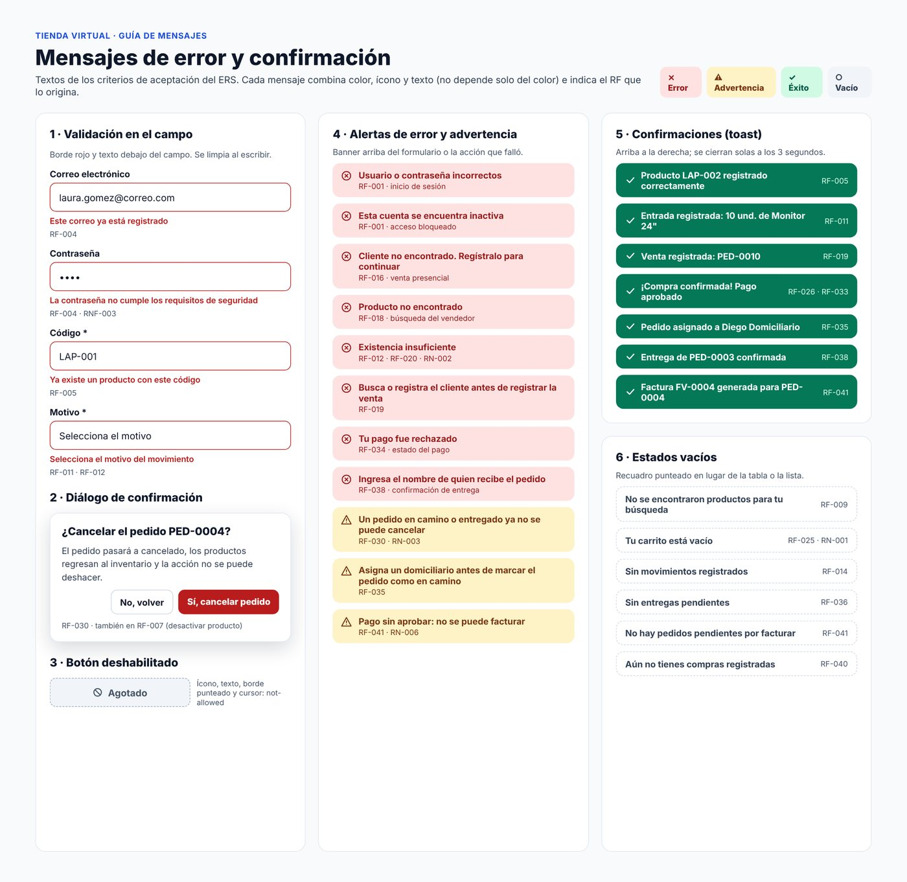

---

## 📌 Siguiente iteración

- Usuarios y roles (RF-002, RF-003) — Administrador
- Edición de datos de cliente (RF-017) — Vendedor
- Reportes (RF-043) — Administrador

> Los datos del mockup son los del script SQL de la Fase 4, ampliados con algunos registros de ejemplo.
